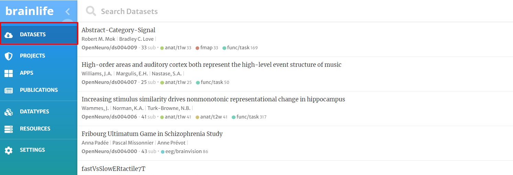
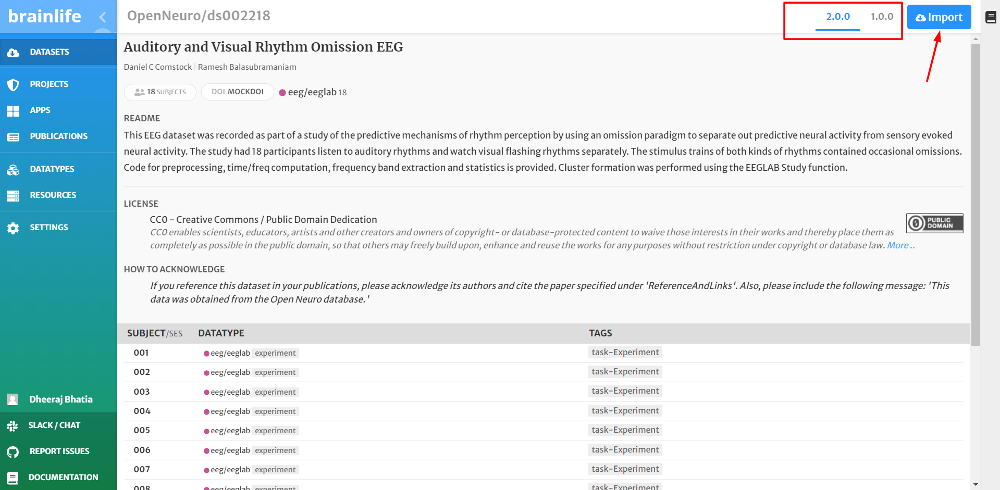
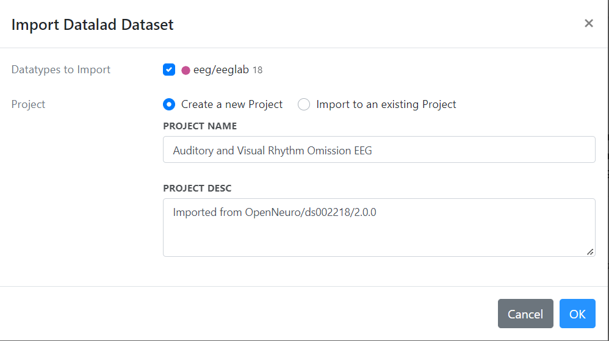

# Datasets

Brainlife provides seamless access to datasets published on OpenNeuro.org as well as on other open datasets.
These datasets can be searched and imported directly from within the Brainlife interface.

Head over to the [Datasets Page](https://brainlife.io/datasets) or click on the Datasets Tab.

Then choose a dataset and then choose the version of the dataset that you would like to use for project.

Choose the dataset you want to import, and then choose a project or create a new project.
Click Ok to import the dataset.

Datasets can be imported either in a new Brainlife Project or into an existing project.

## What comes with an imported dataset

Besides the data objects of the datatypes you pick, an import brings the dataset's tables into the project:

- **`participants.tsv`** (and `participants.json`) is merged into the project's participants table. New subjects and new columns are added; values already in the project are kept, so your own edits are never overwritten.
- **Other BIDS tables** (`phenotype/*.tsv`, `samples.tsv`, and the sessions and scans tables) are copied into the project as [project tables](tables.md), each row linked to its subject and session. Rows of a scans table are also linked to the imported data object that holds their file.

The tables are read from OpenNeuro through the [OpenNeuro API](https://openneuro.org/crn/graphql), for the dataset version you import. Importing the same dataset again replaces the tables that came from it; tables you uploaded yourself are kept.
