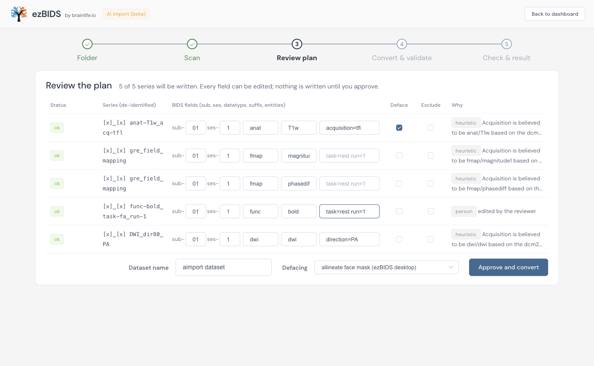
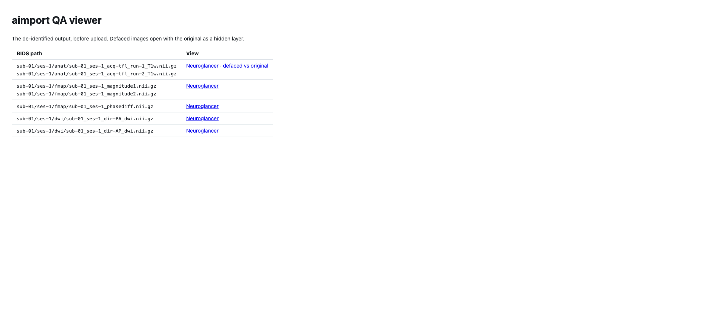
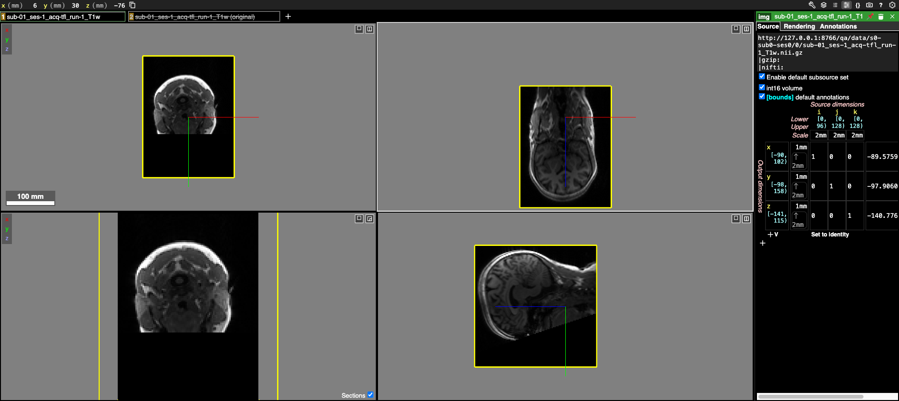
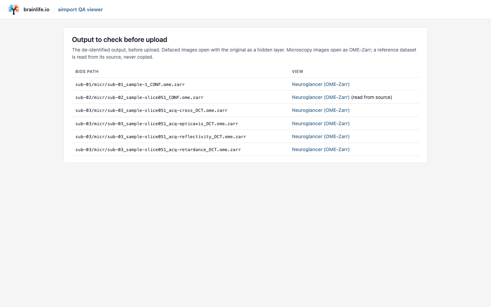
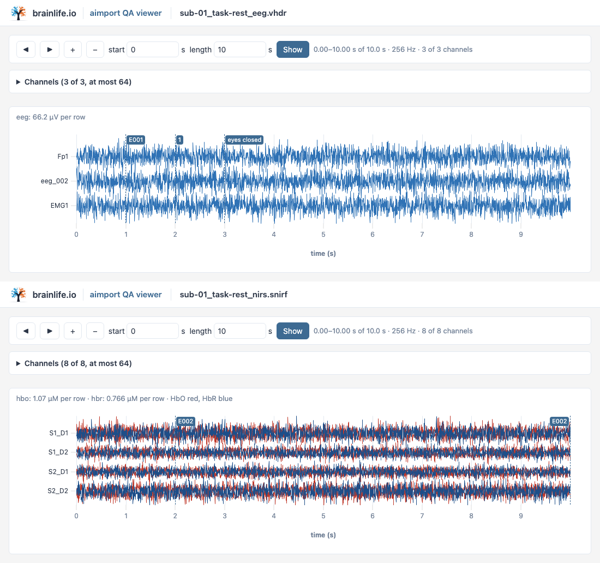
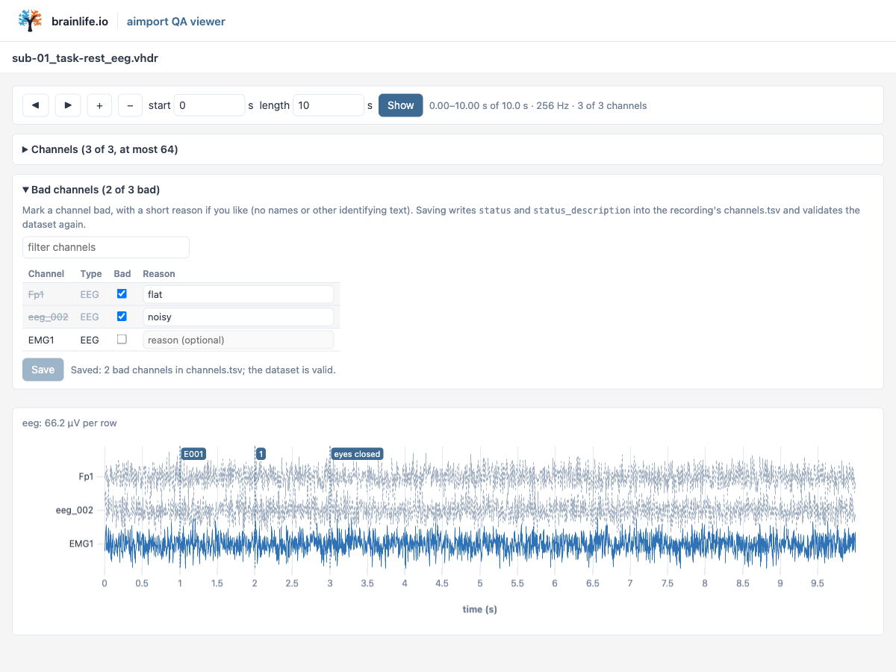
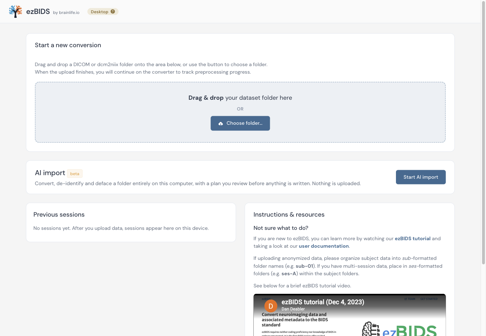

# **aimport User Documentation**

**brainlife.io/aimport** brings neuroscience data (neurophysiology, neuroimaging and microscopy) into brainlife.io from your own computer. It works out what each series, image or recording is, converts it to [BIDS](https://bids-specification.readthedocs.io/en/v1.11.2/), removes identifying information, validates the result and lets you look at it. Only then is anything uploaded.

aimport is part of [ezBIDS](using_ezBIDS.md) and reuses its mapping, conversion and defacing tools. ezBIDS on the web runs on a server; aimport runs on your computer, so raw data never leaves it.

| | ezBIDS on the web | aimport (on your computer) |
|---|---|---|
| Neuroimaging | MRI, PET | MRI, PET |
| Neurophysiology | MEG | EEG, MEG, iEEG, NIRS, EMG |
| Microscopy | | OME-TIFF, CZI, ND2, LIF, SVS, PS-OCT, light-sheet (VISoR), OME-Zarr |

!!! note "Status"
    `bl aimport` is in the [brainlife command-line tool](https://github.com/brainlife/cli#bl-aimport) on its `master` branch; it is not in a published `bl` release yet. It runs the aimport engine, a Docker image you build from the [ezBIDS repository](https://github.com/brainlife/ezbids/tree/master/aimport). **ezBIDS desktop** with AI import (beta) is coming, Mac first.

## Running it

With Docker installed, the engine image built and `bl login` done:

```
bl aimport ~/data/my-study --project PROJECT_ID --qa
```

- `--qa`: after validation, open the output in the local QA viewer and ask before uploading.
- `--remote <url>`: add a remote microscopy source (`https://` or `s3://` OME-Zarr, NIfTI or TIFF), read by range requests, never downloaded whole. Repeatable.
- `--deface pydeface|quickshear`, `--work <dir>`, `--keys <dir>`, `--no-upload`, `--yes`: see the [bl README](https://github.com/brainlife/cli#bl-aimport).

To let an AI model help name the series, set `AIMPORT_MODEL` and your provider's key (Claude, OpenAI, or Qwen through Ollama, which keeps everything local). Without a model, built-in heuristics do the work.

## The flow

1. **Scan** the folder: what each series, image or recording is.
2. **Review the plan**: BIDS names, subject and session IDs, defacing, event names, metadata files. Every field can be edited.
3. **Approve**. Nothing is written before this; any later edit un-approves the plan.
4. **Convert and de-identify**: write BIDS, deface MRI, strip identifiers.
5. **Validate** with the BIDS validator (BIDS v1.11.2). Output with errors is never uploaded.
6. **Look** at the output in the QA viewer.
7. **Upload** to your brainlife.io project.



## What never leaves your computer

- The input folder (read only), original headers and file paths, the images before defacing.
- The **pseudonym key** that links real identities to the new subject IDs. Keep it backed up; it lets a later import of the same person reuse their ID.
- A remote or local OME-Zarr's chunk map.

An AI model, if you set one, sees only a de-identified summary of each series, with every known identifier replaced by `[x]`. Never pixels, raw headers or paths.

## Per modality

### MRI and PET

DICOM or NIfTI. Identifying DICOM fields are dropped, names and IDs are redacted wherever they appear (descriptions, folder names, tables, README), dates are shifted by a fixed offset per subject (intervals kept), NIfTI header text is cleared, ages above 89 are written as 89. Anatomical images are defaced; only face voxels change. Screenshot and report series are excluded by default. ASL is excluded unless an `aslcontext.tsv` is supplied.

### EEG, MEG, iEEG, NIRS, EMG

| Datatype | Accepted input | Written as |
|---|---|---|
| eeg | EDF/EDF+, BDF, GDF, BrainVision, EEGLAB, Neuroscan `.cnt`, Nihon Kohden, Persyst, FIF | BrainVision, EDF, BDF |
| ieeg | the EEG formats, NWB | BrainVision, EDF (NWB input: NWB) |
| emg | the EEG formats with EMG channels | EDF, BDF |
| meg | FIF, CTF `.ds`, KIT, BTi/4D | FIF |
| nirs | SNIRF, NIRx, Hitachi | SNIRF |

Every recording is converted, never copied. **Removed**: patient and recording header fields, experimenter, device IDs; dates are shifted to before 1925 (`scans.tsv` keeps the per-subject shifted date); free-text annotations become event codes (`E001`, ...) that you name in review; channel names holding an identifier are renamed (`eeg_007`); head-shape points are dropped unless you keep them (fiducials and HPI coils stay). A final check re-reads every written file.

**Not converted** (planned `unsupported`, with the reason): Artinis `.oxy3/4/5` ("export to SNIRF first"), MEF3 ("export to EDF first"), EGI `.mff`, Blackrock, EEGLAB `.set` above 512 MB with embedded data, epoched or averaged FIF.

### Microscopy

**Read**: OME-Zarr (NGFF 0.4 and 0.5), OME-TIFF, TIFF/BigTIFF (VISoR light-sheet stacks included), Aperio SVS, CZI, ND2, LIF, PS-OCT NIfTI and MATLAB `.mat`. Written as OME-Zarr.

**Not read** (the plan says why): `.vsi`, `.oib`, `.oif`, `.ims`, `.lsm`, `.scn`, `.mrxs` ("export to OME-TIFF or OME-Zarr first"); raw PS-OCT `.dat` tiles ("reconstruct first"); unstitched tile mosaics ("stitch first"); PNG/JPEG; BIDS `photo` files.

- **Metadata rebuilt** from an allowlist of image facts; the source's OME-XML, TIFF tags, slide labels and file names are never written.
- **Pixel size is never invented**: it comes from the source; if it or its unit is missing, the plan waits for you to set it.
- **Labels and donors are pseudonymised**: subject IDs come from the pseudonym key; sample and chunk labels are kept only when safe, else renumbered.
- **Reference datasets**: an OME-Zarr input, local or remote, is read in place. aimport writes only new metadata; the chunks stay where they are and are streamed into brainlife.io on upload, one at a time.

## Look before you upload: the QA viewer

Everything is served from your own computer (`127.0.0.1`), from the output only.

- **MRI**: Neuroglancer, with each defaced image next to its original. The original shows the face: never screenshot or share it.
- **Microscopy**: OME-Zarr in Neuroglancer; PS-OCT contrasts (reflectivity, retardance, optic axis) open as separate panels, never blended.
- **EEG, MEG, iEEG, NIRS, EMG**: snapshots plus an interactive trace viewer (pan, zoom, event markers; NIRS as HbO/HbR).









**Bad channels.** In the trace viewer, tick a channel bad, add a reason (flat, noisy, bridged, disconnected) and **Save**. aimport writes `status` and `status_description` into the recording's `channels.tsv` and validates again.



## On brainlife.io

| BIDS | brainlife.io |
|---|---|
| MRI, PET | `neuro/anat/t1w`, `neuro/dwi`, `neuro/func/task`, `neuro/fmap`, ... |
| microscopy | `neuro/ome-zarr`, one object per image, tagged with the technique (for example `OCT`) |
| EEG, MEG | `neuro/eeg/*`, `neuro/meg/*`; `channels.tsv` (with bad channels) kept as the `channels` file |
| iEEG, NIRS, EMG | project files with the BIDS tree (brainlife datatypes are drafts for now) |

The mapping is one file, [`bids_brainlife_map.yaml`](https://github.com/brainlife/ezbids/blob/master/aimport/src/aimport/data/bids_brainlife_map.yaml).

## ezBIDS desktop (coming)

ezBIDS desktop adds **AI import (beta)**: the same engine with no Docker, Mac first. Pick a folder, review the plan, convert, and check the result in the QA viewer, which opens inside the app window. No model key is set, so nothing leaves the machine. Uploading to brainlife.io from the app comes in a later version.



## Known limitations

- A name that appears **only in free text** (a README, a note), and in no header or table aimport reads, cannot be detected. Read free text in review.
- A column you keep against the default drop is redacted only for known identifiers.
- Continuous recordings only; bad time segments are not marked.

## Learn more

- Engine README: [aimport/README.md](https://github.com/brainlife/ezbids/blob/master/aimport/README.md)
- `bl aimport`: [cli README](https://github.com/brainlife/cli#bl-aimport)
- Test datasets: [aimport/tests/DATASETS.md](https://github.com/brainlife/ezbids/blob/master/aimport/tests/DATASETS.md)
